

    

# Commodore 64 Breadbin

 

# Table of contents

<!-- TABLE OF CONTENTS -->

TOC - Click to enlarge

  <ul>
    <li>
      <a href="#starting-point">Starting point</a>
    </li>
    <li>
      <a href="#refurbishment-activities">Refurbishment activities</a>
    </li>
    <li>
      <a href="#disassembly">Disassembly</a>
    </li>
    <li>
      <a href="#mainboard">Mainboard</a>
    </li>
      <ul>
        <li>
          <a href="#visual-inspection">Visual inspection</a>
        </li>
        <li>
          <a href="#initial-testing">Initial testing</a>
        </li>
        <li>
          <a href="#checking-the-voltages">Checking the voltages</a>
        </li>
        <li>
          <a href="#cleaning-the-user-and-datasette-port">Cleaning the user and datasette port</a>
        </li>
        <li>
          <a href="#adding-heatsinks">Adding heatsinks</a>
        </li>
      </ul>
    </li>
    <li>
      <a href="#keyboard">Keyboard</a>
      <ul>
        <li>
          <a href="#removing-and-cleaning-the-keycaps">Removing and cleaning the keycaps</a>
        </li>
        <li>
          <a href="#cleaning-the-keyboard-pcb">Cleaning the keyboard PCB</a>
        </li>
        <li>
          <a href="#reviving-the-keyboard-plungers">Reviving the keyboard plungers</a>
        </li>
      </ul>
    </li>
    <li>
      <a href="#casing">Casing</a>
      <ul>
        <li>
          <a href="#removing-the-power-led">Removing the power LED</a>
        </li>
        <li>
          <a href="#cleaning-the-covers">Cleaning the covers</a>
        </li>     
      </ul>
    </li>
    <li>
      <a href="#testing">Testing</a>
      <ul>
        <li>
          <a href="#basic-functionality-and-chips">Basic functionality and chips</a>
        </li>
        <li>
          <a href="#diagnostics-test-with-harness">Diagnostics test with harness</a>
        </li>
        <li>
          <a href="#testing-the-full-64k-of-ram">Testing the full 64k of RAM</a>
        </li>
        <li>
          <a href="#extended-testing">Extended testing</a>
        </li>
      </ul>
    </li>
    <li>
      <a href="#final-result">Final result</a>
    </li>
  </ul>

# Starting point

This Commodore 64 breadbin is reportedly having issues with the sound, but otherwise it looks really nice. There is some dust and dirt, especially in the grooves beneath the metal badges, but I can not see any mechanical damage to the covers. Also, there is almost no yellowing on the covers which is quite rare these days.

I notice that this Commodore 64 have been repaired before as there is a sticker from the service shop: retroservice.no which is no longer operational. Also, I notice that different screws have been used to mount the bottom cover. One Phillips screw, and two Pozidrive screws. 

Below are some pictures of the breadbin Commodore 64 before refurbishment.

    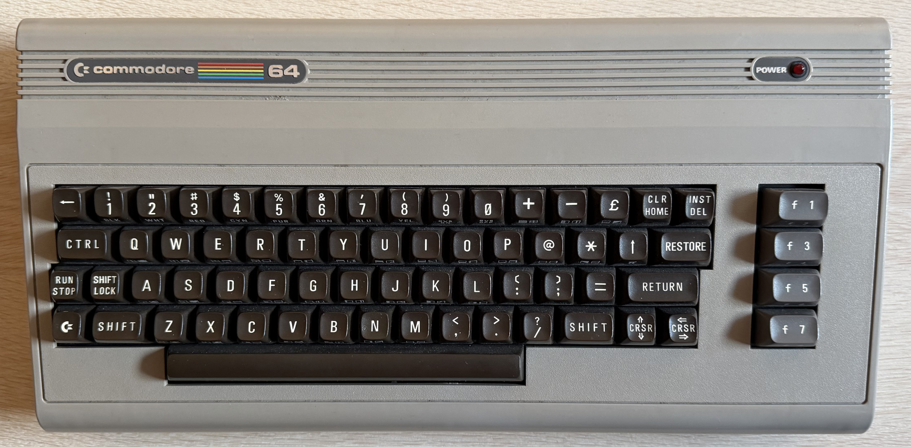
    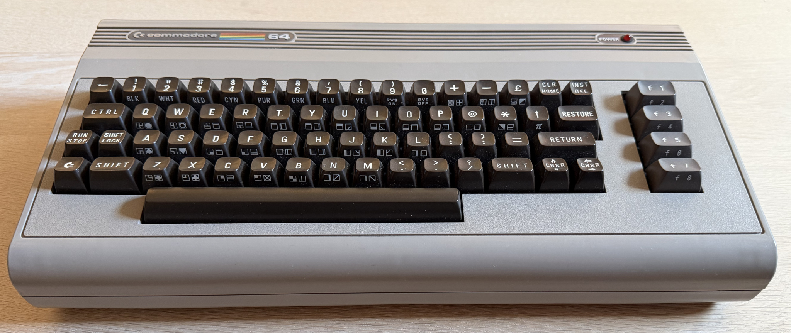
    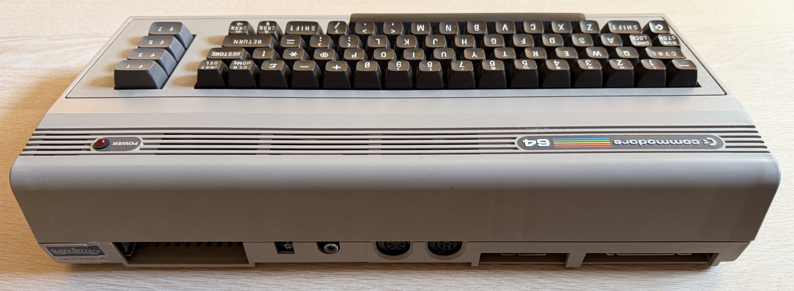
    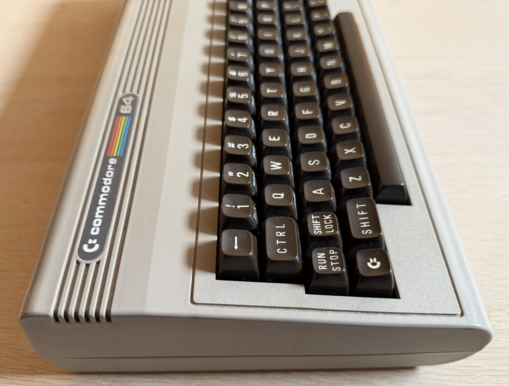
    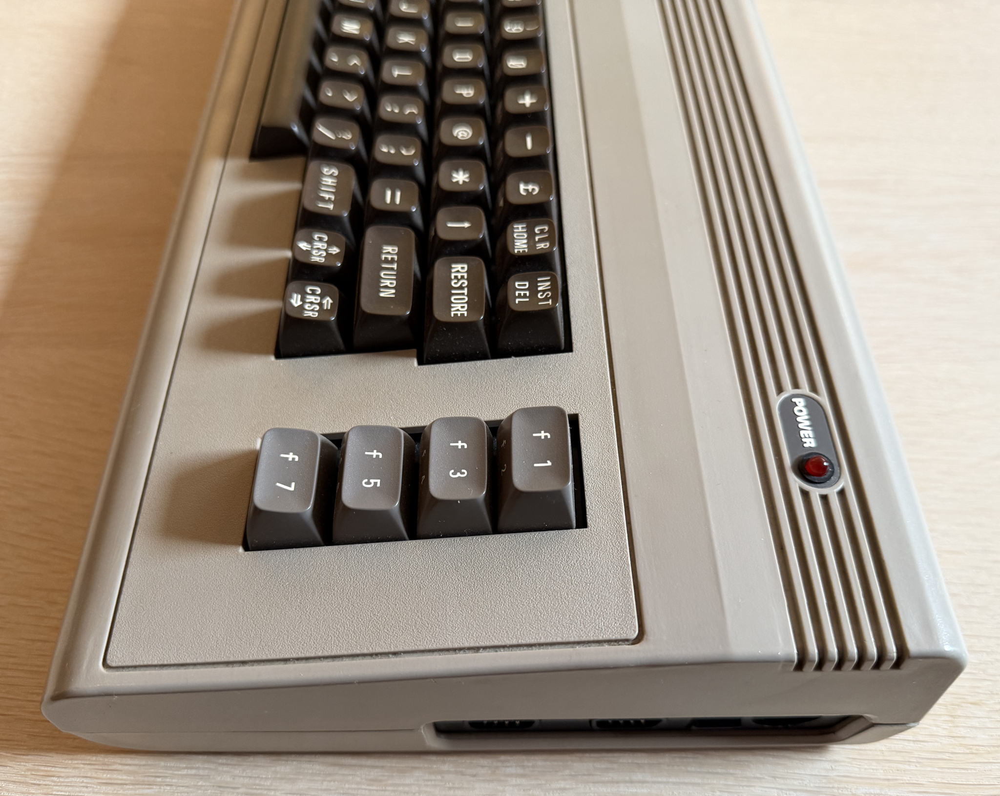
    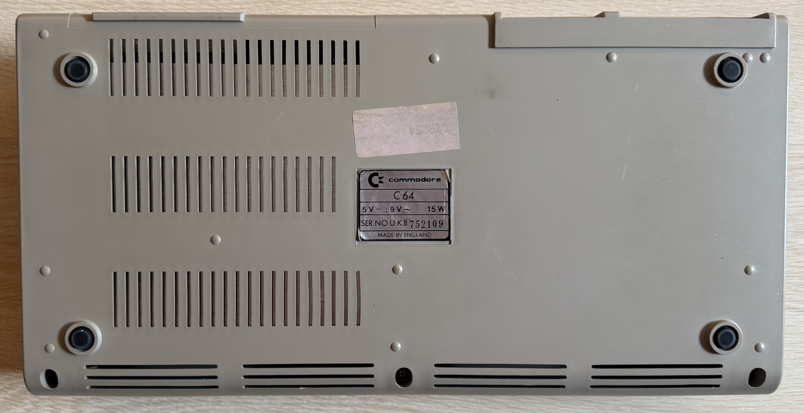

# Refurbishment activities

The planned refurbishment activites for this Commodore 64 (Order may vary. Several of them in parallel):

- [ ] Refurbish mainboard
- [ ] Refurbish the keyboard
- [ ] Refurbish the casing
- [ ] Testing and validation

The plan can be updated during the refurbishment process. Sometimes I discover areas that needs special attention.

# Disassembly

The first step in the disassembly is to remove the two Pozidrive screws, and the single Phillips screw[^1][^2] on the underside. The Phillips screw is the middle screw, and the two Pozidrive screws are to the right and left.

    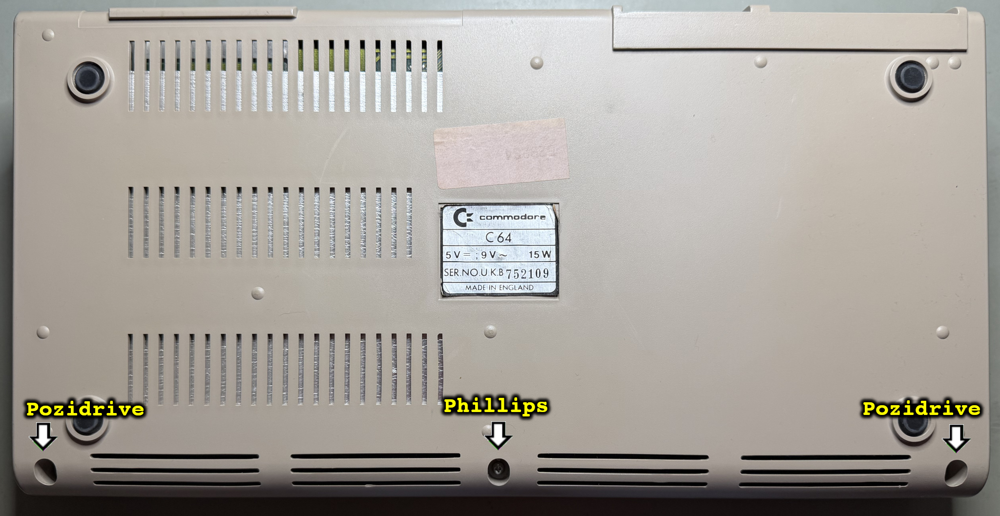

    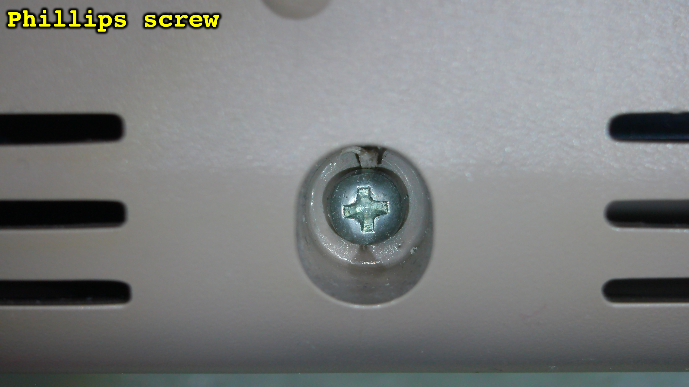
    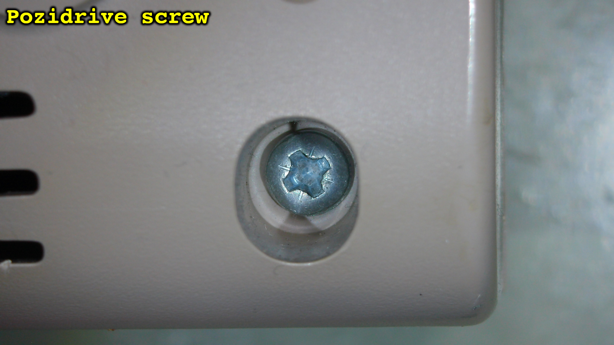

The machine is flipped over again, and the top cover is carefully lifted about 30 degrees and wiggled off. Now the interior is exposed, and I can see immediately that this machine has been stored in a good place. There is hardly any sign of moisture on the RF-shield cardboard. Usually, these RF-shields show sign of moist due to been stored in humid environments. 

    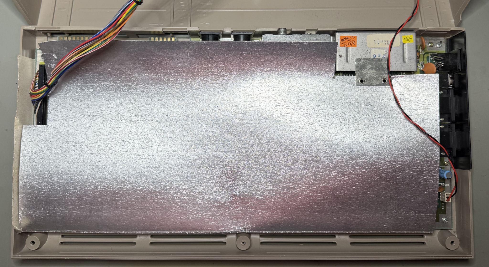

Also, I notice that three out of the six the rear clips, which are used to mount the backside of the top cover to the bottom cover, are broken. This is very normal. These clips are very brittle and break easily.

    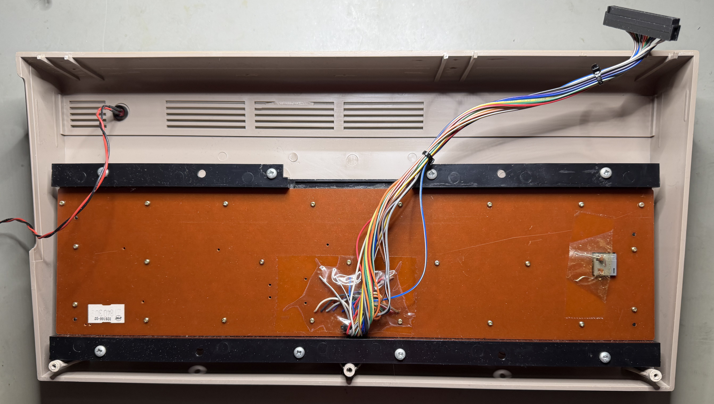

    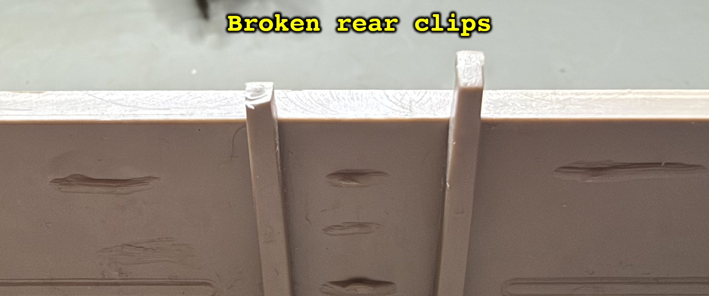

The cardboard RF shield is lifted away, and the PCB is exposed in all its glory. Now it is clear to me why this Commodore 64 has been repaired before: there is a modern PLA replacement installed (PLAnkton), and a nice sticker from "retroservice.no" (no longer in service). There are some dust and grease inside, but nothing significant. There are no signs of corrosion, neither on the PCB itself nor on the metal parts (VIC-II shield, cartridge connector, and RF modulator). This is another indication that this Commodore 64 has been stored in a dry, temperature-stable environment.  

    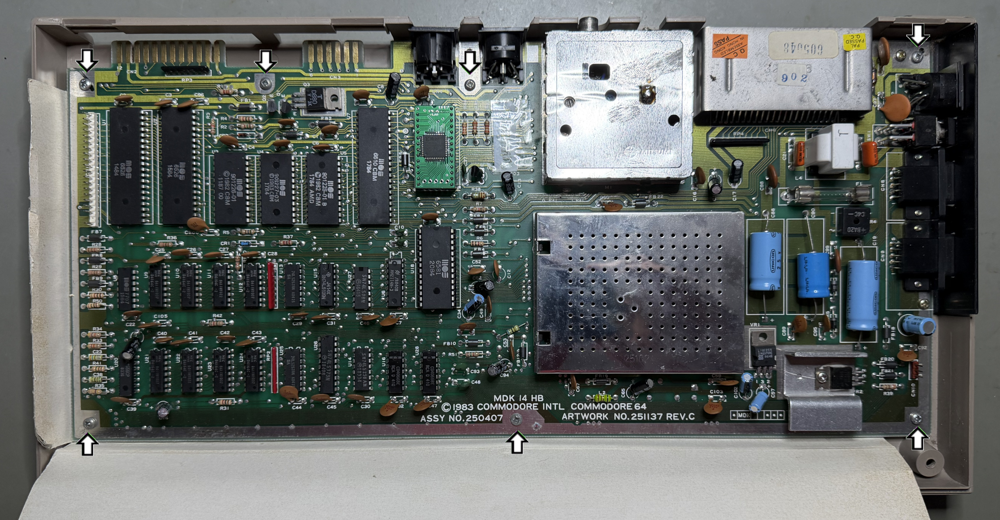

All seven Phillips screws[^3] are in place, holding the PCB to the bottom cover (see arrows in picture above). They are removed with a low-torque screwdriver to free the PCB from the bottom cover. With the PCB out of the way, the inside of the bottom cover is visible. It seems to be in fine condition. 

    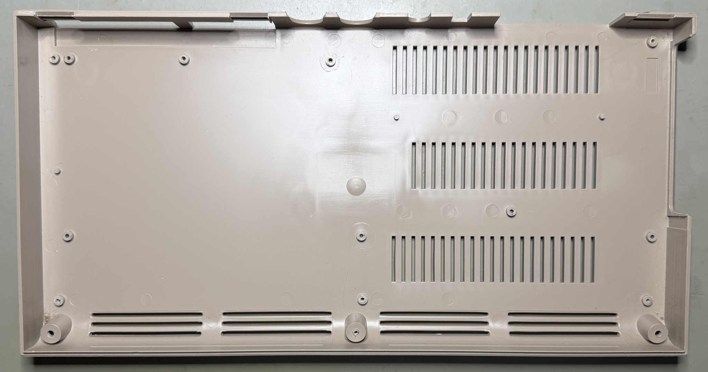

# Mainboard

The mainboard is Assy 250407 / Artwork 251137 Rev C. This is one of the early revisions of the mainboard, characterized by having the full PLL clock circuitry and the VIC-II positioned vertically. It is not the earliest revision, though, so the A/V connector is a full eight-pin version with LUMA and CHROMA output.

## Visual inspection

The mainboard appears to be in good condition. This board has been repaired repaired before, and the sticker with "retroservice.no" is not the only sign of repair. There are three areas which points to previous repair(s):

- PIN #1 - #8 on the keyboard connector (CN1) have been re-soldered. Unsure why this is done.
- The BASIC ROM in position U3 is replaced. Significant flux residue.
- The PLA in position U17 is replaced. Significant flux residue.

And in addition I notice that there is quite some flux residue, and something that looks like re-work, around PIN #5 - #8 on the RF-modulator. Further on, one of the anchor point is not soldered, and one of the metal tabs are not bent in position.  I don´t actually think this is re-work, but a result of a busy day at the factory in 1984.

None of the capacitors show sign of bulging or leakage.

There are also some more things I notice:

- There is a MOS 7707 chip. These MOS logic chip are notorious for failing and should be replaced.
- Both the USER-PORT and the DATASETTE-PORT are a bit worn
- The thermal paste on the VIC-II is dried out

The table below lists all major custom ICs found on the mainboard. As shown, the MOS chips were produced between week 11 of 1984 and week 20 of 1984, suggesting this Commodore 64 was likely manufactured during the summer of 1984. The same summer that the movie Ghostbuster was released!

    
| Chip/Area | Manufactor | Version | Date code | Socket | Note |
|:----------:|:----------:|:----------:|:----------:|:----------:|:----------:|
| CPU | MOS | 6510 | W17 Y1984 | No |  |
| SID | MOS | 6581 | W20 Y1984 | Yes |  | 
| VIC-II | MOS | 6569R3 | W13 Y1984 | Yes |  |
| PLA | PLAnkton | V1.08 | Unknown | Yes | From a previous repair|
| CIA #1 | MOS | 6526 | W14 Y1984 | No | |
| CIA #2 | MOS | 6526 | W14 Y1984 | No | |
| ROM - BASIC | MOS | 901226-01 | W11 Y1987 | No | From a previous repair |
| ROM - Kernal | MOS | 901227-03 | W17 Y1984 | No | 3rd revision |
| ROM - Character | MOS | 901225-01 | W17 Y1984 | No | |
| RAM | NEC | D4164C-2 | W11 Y1984 | No | No MT RAM |
| Glue logic | MOS, EXAR, Signetics, Texas Instruments, Motorola, National Semiconductor, Fairchild and RCA |  |  |  | MOS glue logic(!) |

Below are some pictures of the mainboard before refurbishment.

    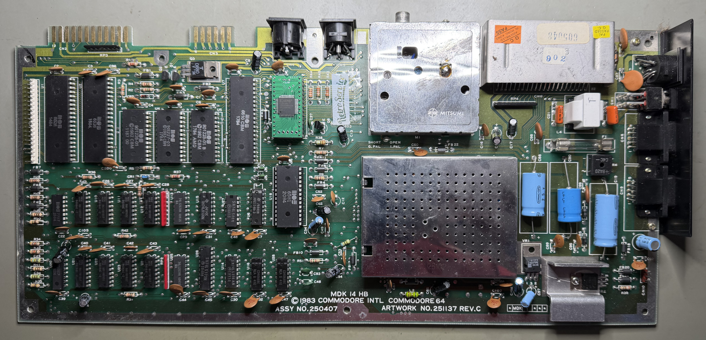
    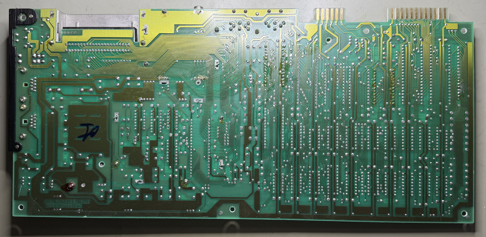

Close-up of the VIC-II can area.

    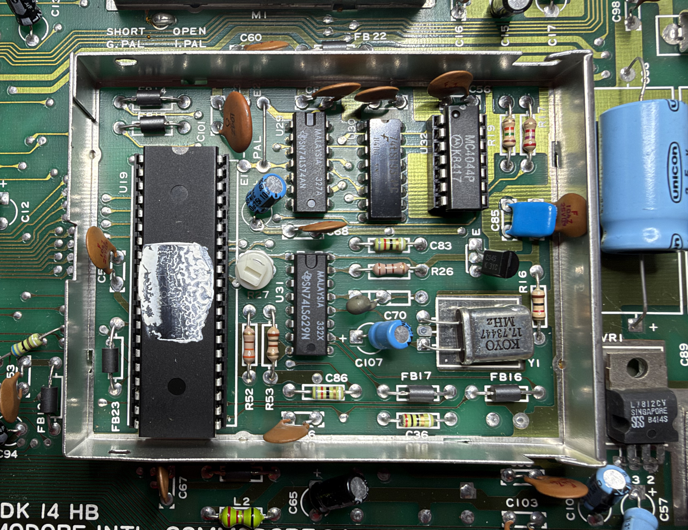

Below are some pictures taken with a microscope of the mainboard before refurbishment.

    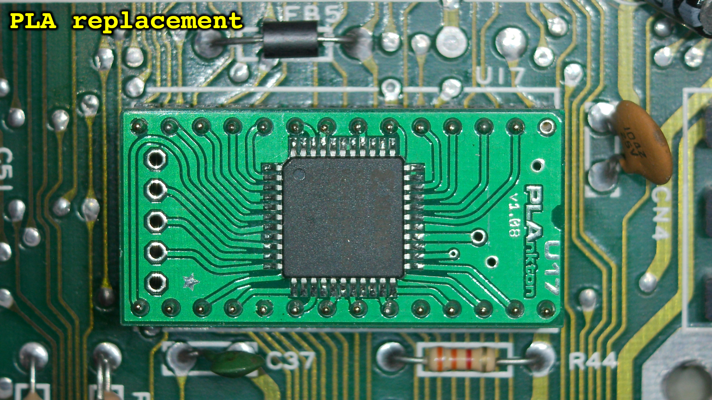
    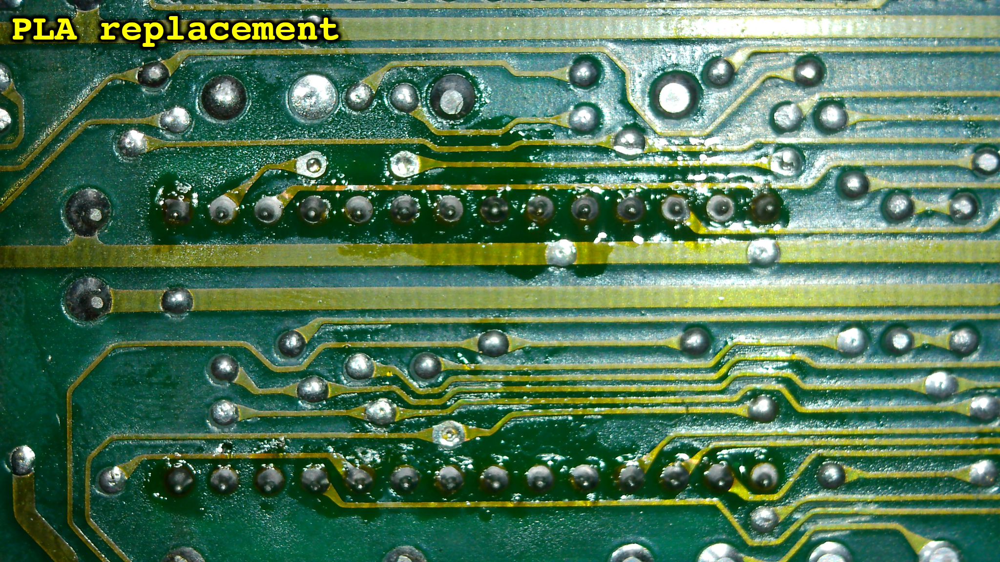

    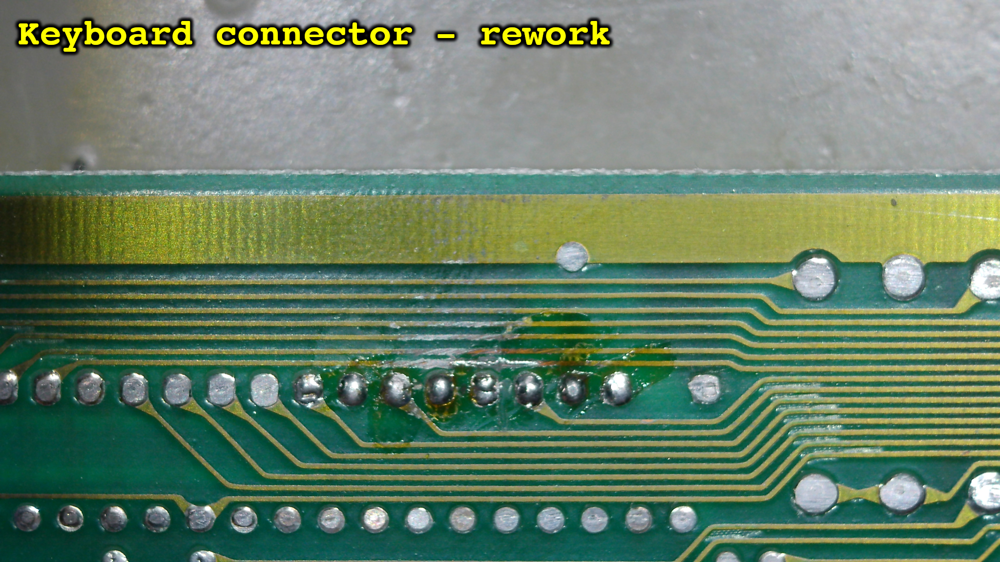
    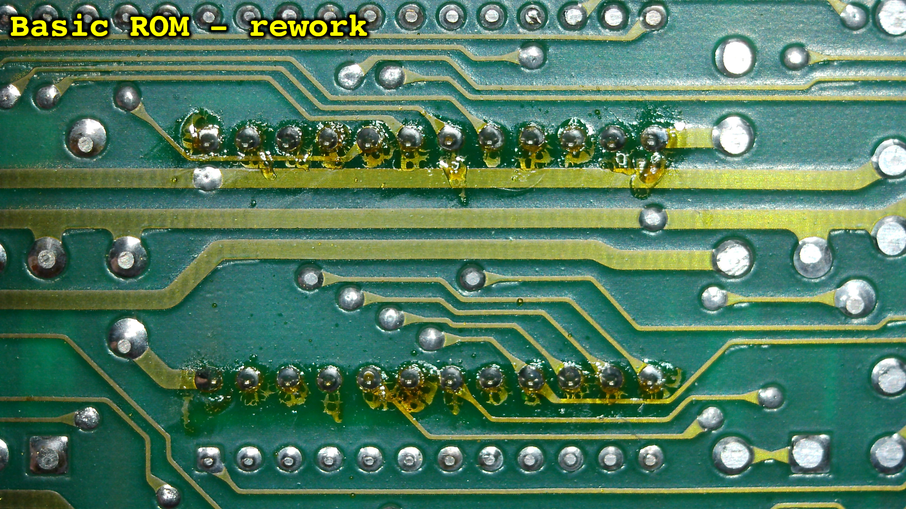

    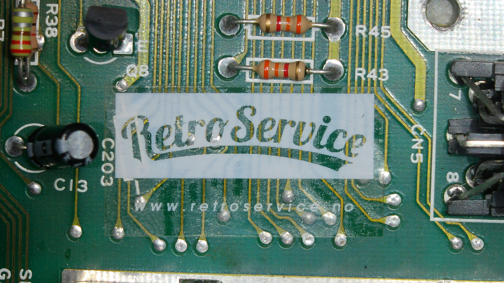

## Initial testing

Some initial tests are performed to check the health of the machine, determining whether the basic functions work as they should and, if not, whether any useful information can be gathered from these diagnostic tools.

When running the Diagnostic Cartridge, the full test harness is used.

    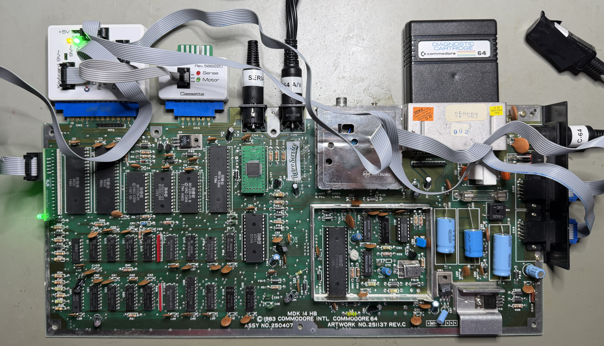

The results of the initial testing are shown in the table below (see screen thumbnails)—click to enlarge:

  
| Test ID | Test area | Test criteria | Result | Comment |
|:---------:|:----------|:----------|:----------:|:----------|
| #1 | Boot-up | Default blue screen showing 38911 BASIC Bytes Free | PASSED | Flashing cursor present |
| #2| DeadTest | Passing all tests | PASSED |  |
| #3| Diagostics Cartridge| Passing all tests | PASSED | |
| #4| DesTestMAX | Passing all memory tests | PASSED | |
| #5| DesTestFULL | Passing all memory tests | PASSED | |

    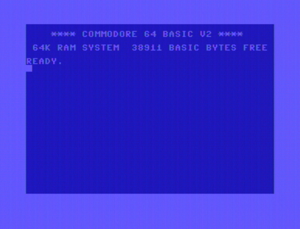
    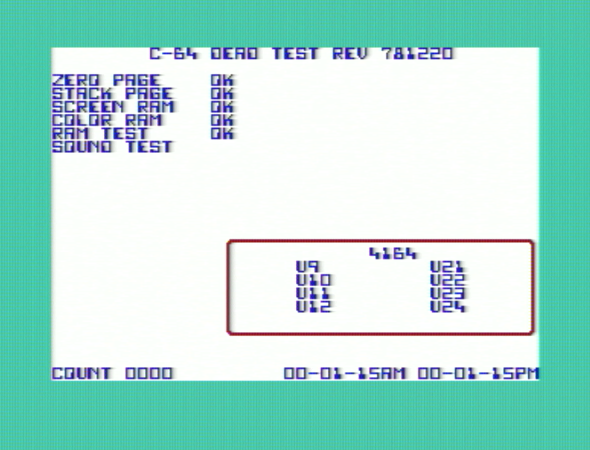
    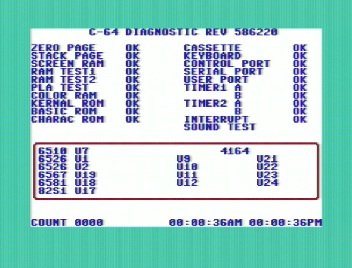
    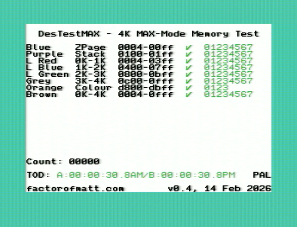
    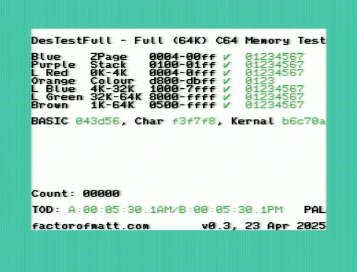    

## Checking the voltages

Voltages are measured before—and after—refurbishment. This is to ensure that all voltages are within acceptable levels. The table is updated after the refurbishment is completed. All voltages are measured according to the article Checking C64 Voltages [(HOWTO-Checking the Commodore 64 voltages)](https://refurbished-commodore.com/checking-c64-voltages).

The Commodore 64 is powered using a Ray Carlsen PSU.

As seen in the table below, all voltages are within acceptable levels.

  
| Measure point | Target voltage | Measured voltage Before refurbish| Measured voltage After refurbish | Note |
|:----------:|:----------:|:----------:|:----------:|:----------:|
| PSU (5V) | 5 V DC | 5.054 V | TBD  V | User port |
| PSU (9V) | 9 V AC | 8.363 V | TBD V | User port |
| Vvid (+5 CAN)| 5 V DC | 4.928 V | TBD V | Pin #40 VIC-II |
| Vc (+5 CAN) | 5 V DC | 4.963 V | TBD V | Pin #14 4044 |
| Regulated (12V) | 12 V DC | 12.03 V | TBD V| Pin #28 SID |
| Unregulated (9V) | 9 V DC | 8.785 V | TBD V | R2 |

**Footnotes**
[^1]: Phillips pan head (5.5 mm), Sheet metal screw, Fully threaded, Thread diameter: 3.0 mm, Fastener length: 9.0 mm
[^2]: Pozidrive pan head (6.8 mm), Sheet metal screw, Fully threaded, Thread diameter: 3.5 mm, Fastener length: 9.0 mm
[^3]: Phillips pan head (5.3 mm), Sheet metal screw, Fully threaded, Thread diameter: 3.0 mm, Fastener length: 6.0 mm
